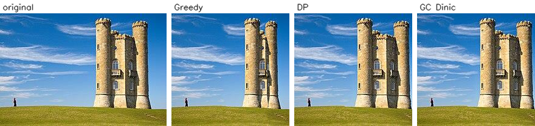

# Seam Carving

Content-aware image resizing in C++. The image gets narrower or shorter by removing
the least important pixels, so the important parts keep their shape. Three ways
of finding those pixels are implemented and compared: **Dynamic Programming**,
**Greedy** and **Graph Cut** (max-flow / min-cut).



*274 px wide → 194 px. The castle and the person are untouched; sky and grass were removed.*

**How it works:** compute an energy map (edges = high energy) → find the cheapest
connected top-to-bottom path of pixels (a *seam*) → remove it → repeat.

## Results

Tower image, 274×186 → 194×150 (80 vertical + 36 horizontal seams), one run on one machine:

| Method | Best possible seams? | Energy removed (lower is better) | Time |
|---|---|---|---|
| Dynamic Programming | Yes | 668 244 | 0.16 s |
| Greedy | No | 1 377 798 (2.1× worse) | 0.14 s |
| Graph Cut (Dinic) | Yes, identical to DP | 668 244 | 69 s |

**DP is the one to use:** optimal and fast. Greedy is barely faster and cuts into
important content; Graph Cut finds the same seams as DP but is about 400× slower.

## Quick start

Needs CMake and Visual Studio 2022 (or g++ / clang on Linux/macOS). OpenCV is
downloaded automatically by vcpkg on the first build.

```bat
cmake --preset vs2022
cmake --build --preset vs2022-release
out\build\vs2022\Release\seam_carve.exe images\tower.png out.png 194 0 dp
```

Arguments: `<input> <output> <width> <height> <dp|greedy|gc-dinic|gc-ek> [backward|forward]`.
A size of `0` keeps that dimension; run with no arguments for a menu. It also
writes `out_seams.png` showing the removed seams. Run the tests with
`ctest --preset vs2022-release`. On Linux/macOS use the `unix-release` presets.

## More detail

- [Dynamic Programming](docs/DynamicProgramming/README.md) · [Greedy](docs/Greedy/README.md) · [Graph Cut](docs/GraphCutting/README.md): how each works, complexity, measurements.
- Code: `SeamCarving.h/.cpp` is shared (energy map, seam removal, carving loop); each algorithm has its own `.h/.cpp`; tests are in `tests/`.
