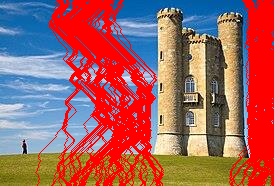
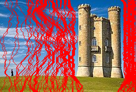
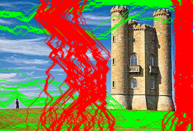

# Seam Carving by Dynamic Programming

Item 1 of Assignment 2. Content-aware resizing by repeatedly finding the
minimum-energy seam with **dynamic programming** and removing it, for both
vertical and horizontal seams. OpenCV is used only for image I/O, `cvtColor`,
`Sobel` and `transpose`; no library resizing or retargeting function is used.

| File | Purpose |
|---|---|
| [`DynamicProgramming.h`](../../DynamicProgramming.h) / [`DynamicProgramming.cpp`](../../DynamicProgramming.cpp) | Energy map, cumulative table, vertical/horizontal seams, seam removal, carve loop, seam overlay |
| [`main.cpp`](../../main.cpp) | Algorithm menu: DP or Graph Cut (Dinic / Edmonds–Karp), backward or forward energy |
| [`tests/DynamicProgrammingTests.cpp`](../../tests/DynamicProgrammingTests.cpp) | Energy map tests (327 checks) |
| [`tests/SeamTests.cpp`](../../tests/SeamTests.cpp) | Minimum-seam tests for step (b) (1 054 checks) |
| [`tests/CarveTests.cpp`](../../tests/CarveTests.cpp) | Seam removal and carve loop tests (80 checks) |
| [`results/`](results) | Output images used below |

## Quick start

Windows, "x64 Native Tools Command Prompt for VS 2022", from the repository root
(adjust `CV` to where OpenCV 4 is unpacked):

```bat
set CV=C:\opencv\build
set PATH=%CV%\x64\vc16\bin;%PATH%
cl /nologo /std:c++14 /EHsc /O2 /MD /I. /I"%CV%\include" main.cpp DynamicProgramming.cpp GraphCutting.cpp /Fo:build\ /Fe:build\seamcarve.exe /link /LIBPATH:"%CV%\x64\vc16\lib" opencv_world4140.lib
build\seamcarve.exe images\tower.png build\out.png 194 0 dp
```

Linux / macOS:

```bash
g++ -std=c++14 -O2 -I. main.cpp DynamicProgramming.cpp GraphCutting.cpp -o seamcarve `pkg-config --cflags --libs opencv4`
./seamcarve images/tower.png out.png 194 0 dp
```

`seamcarve <input> <output> <newWidth> <newHeight> <dp|gc-dinic|gc-ek> [backward|forward]`.
A width or height of **0 keeps the original size**; run it with no arguments
for an interactive menu (Enter keeps the size). It writes the resized image
and `<output>_seams.png` (removed seams on the original: red = vertical,
green = horizontal).

```cpp
#include "DynamicProgramming.h"

DP::CarveStats st;
cv::Mat out = DP::Carve(img, 194, img.rows,               // new width, new height
                        DP::EnergyType::Backward,         // or Forward
                        &st, /*recordSeams*/ true);
cv::imwrite("seams.png", DP::DrawSeams(img, st));

std::vector<int> seam = DP::FindVerticalSeam(DP::ComputeEnergy(img));   // seam[row] = col
```

---

## 1. Algorithm

### 1.1 Energy map (step a)

`ComputeEnergy` returns one non-negative integer per pixel (`CV_32S`), on the
grayscale image:

* **Backward** (default): `e = |Sobel_x| + |Sobel_y|`, 3×3 kernel, reflected
  borders. High on edges and texture, low in flat areas.
* **Simplified forward**: `c[i][j] = |I[i][j+1] − I[i][j−1]|`, the new edge
  created when pixel (i, j) is removed and its left and right neighbours meet.

Both formulas are identical to `GraphCut::ComputeEnergy`, so all methods are
compared on the same cost map (the tests check this pixel for pixel).

### 1.2 Minimum seam (step b)

A vertical seam has one pixel per row, and pixels in consecutive rows are at
most one column apart. The cumulative table

```
M[0][j] = e[0][j]
M[i][j] = e[i][j] + min(M[i−1][j−1], M[i−1][j], M[i−1][j+1])
```

stores the cheapest seam ending at (i, j). The seam ends at the smallest value
of the last row and is traced upwards, each time moving to the cheapest of the
(up to) three cells above. Ties go to the **left**, both at the bottom row and
during the walk up, so the result is the **leftmost** of all optimal seams.
Graph cut also returns the leftmost optimal seam, which is why the two methods
produce pixel-identical images (§3).

The table is 64-bit (`CV_64F`, exact for integers up to 2^53), so the sums
cannot overflow. No separate back-pointer array is kept: the walk up re-reads
`M`.

A **horizontal** seam is a vertical seam of the transposed energy map, so
`FindHorizontalSeam` transposes and reuses `FindVerticalSeam`.

### 1.3 Remove the seam and repeat (step c)

`Carve(img, newWidth, newHeight)` repeats, until the target size is reached:

1. compute the energy of the **current** image,
2. find the minimum seam,
3. remove it.

The energy is recomputed after every removal: removing a seam makes pixels
neighbours that were not before, so the old map no longer describes the image.

Vertical seams (width) are removed first. The image is then transposed once,
the same loop removes seams until the height is reached, and the result is
transposed back. This is the same order as `GraphCut::Carve`.

`RemoveVerticalSeam` copies each row into an image one column narrower,
skipping the seam pixel. It copies raw bytes (`elemSize`), so it works for any
image type. Invalid seams throw `std::invalid_argument` before anything is
changed.

To draw the removed seams on the original image, a map of every pixel's
original (x, y) is carved alongside the image. It is only built when seams
are recorded (`recordSeams = true` with a `CarveStats`).

## 2. Complexity

N = rows × cols.

| Step, one seam | Time | Memory |
|---|---|---|
| Energy map | O(N) | 4 B/pixel |
| Cumulative table | O(N) | 8 B/pixel |
| Walk up | O(rows) | O(rows) |
| Remove seam | O(N) (copy) | one new image |
| **k seams** | **O(k·N)** | O(N) |

For comparison, graph cut needs about 176 B/pixel for its flow network and
grows faster than linearly per seam (see the
[Graph Cut README](../GraphCutting/README.md#2-complexity)).

## 3. Results

All times: Windows 11, MSVC 2022 x64 `/O2`, OpenCV 4.14.0, seam-finding time
including the energy map. Times vary between runs and machines; the totals and
images do not.

### 3.1 Tower, width only: 274×186 → 194×186 (main comparison)

The brief's example shrinks the width and keeps the height, so this is the
reference case.

| Original | DP, backward energy | Removed seams |
|---|---|---|
|  |  |  |

* The castle and the person are intact and unstretched, and the hill line stays
  flat.
* The 80 seams go through the open sky between the person and the castle and
  the strip right of the castle, continuing down through the grass, the
  lowest-energy routes from top to bottom.
* Total energy removed: **430 676**, the same as graph cut, and the output is
  **pixel-identical** to `GraphCut::Carve`.

The handout example removes 32 % of the width (282 → 192). The same proportion
on this image is about 187 wide:
[`tower_187x186_dp_backward.png`](results/tower_187x186_dp_backward.png)
(87 seams, total 483 680).

### 3.2 Forward energy

| Backward | Forward | Forward seams |
|---|---|---|
|  |  |  |

The results look very similar. With forward energy the seams are spread more
evenly across the sky instead of bunching into a few channels. The totals
(25 520 vs 430 676) are on different scales and cannot be compared. Forward
energy is also cheaper to compute (no Sobel filter): 0.042 s vs 0.169 s for 80
seams. The output is again pixel-identical to graph cut with the same energy.

### 3.3 Both directions: 274×186 → 194×150

| DP result | Removed seams |
|---|---|
|  |  |

80 vertical + 36 horizontal seams, total 668 244 (same as graph cut). The
horizontal seams (green) run mostly through the sky on the left but through the
grass on the right, so more grass rows are removed on the right. That **bends the flat
hill into a slope** that drops towards the castle: the top of the grass is at
row ≈ 124 of 150 on the left but ≈ 142–145 near and right of the castle (in the
original and in the width-only result it is level). The castle and person are not
stretched, but they look larger because the frame is smaller. Removing all
vertical seams first is a simple fixed order. Choosing at each step whichever
seam (vertical or horizontal) is cheaper, or the optimal order from Avidan &
Shamir (2007), would usually bend edges less. This is not implemented.

### 3.4 Synthetic, width only: 180×120 → 130×120


50 seams, total **16 400**, pixel-identical to graph cut.

### 3.5 Running time

| Run | DP | Graph Cut (Dinic) | Greedy |
|---|---|---|---|
| Tower, 80 vertical seams, backward | **0.169 s** (≈ 2.1 ms/seam) | 55.2 s | pending |
| Tower, 80 vertical seams, forward | **0.042 s** | 32.0 s | pending |
| Synthetic, 50 vertical seams | **0.054 s** | 1.43 s | pending |
| Tower, first seam only | 6–7 ms | 214 ms (Edmonds–Karp 1 318 ms) | pending |

* DP is roughly 30–800× faster than graph cut on these runs, for exactly the
  same output. DP's time depends only on the image size; graph cut's also
  depends on the content (the tower is much slower per pixel than the flat
  synthetic image).
* For DP with backward energy, most of the time goes to the Sobel energy map,
  not the DP itself; forward energy is 4× faster for that reason.
* The first-seam DP time includes one-off OpenCV start-up cost, so the
  per-seam average from the 80-seam run is the better figure.

## 4. Tests

| Suite | Checks | What it covers |
|---|---|---|
| `tests/DynamicProgrammingTests.cpp` | 327 | Energy type/size, flat image = 0, step edges, hand-computed forward values, 1/3/4 channels, empty input, equal to `GraphCut::ComputeEnergy` on random images and both sample images |
| `tests/SeamTests.cpp` | 1 054 | Step (b): hand-worked table (64-bit `M`), horizontal = transposed vertical, tie-breaking, brute-force optimality on 300 random maps, 1×1/1×N/N×1, invalid input (empty, wrong type, negative energy, disconnected or out-of-range seams), no overflow beyond `INT_MAX`, `ComputeEnergy` integration |
| `tests/CarveTests.cpp` | 80 | Seam removal (hand examples, colour, coordinate map), invalid seams, output sizes, `Carve` equal to a hand-written energy → seam → remove loop, recorded seams cover every removed pixel exactly once, reference totals (430 676 / 16 400 / 668 244), pixel-identical to `GraphCut::Carve` with both energies |

Build and run any suite like the quick start, replacing `main.cpp` with the
test file (the tests that compare with graph cut also need `GraphCutting.cpp`).
Run from the repository root so `images/` is found.

## 5. Discussion

* **DP is exact and fast.** Each row depends only on the row above, so the
  optimal seam takes one O(N) pass. Graph cut finds the same optimum by solving
  a general max-flow problem, which is far slower and uses about 20× the
  memory.
* **Backward energy protects edges, not shapes.** It keeps the castle and the
  person because they have strong edges, but it has no notion of straight
  lines, so a long low-contrast edge like the hill can bend when many seams
  cross it (§3.3).
* **Limitations.** Shrinking only (no seam insertion for enlarging), a fixed
  vertical-then-horizontal order, and the energy is recomputed for the whole
  image after each seam even though only a narrow band around the removed seam
  changes.

## References

* S. Avidan, A. Shamir. *Seam Carving for Content-Aware Image Resizing.* SIGGRAPH 2007.
* M. Rubinstein, A. Shamir, S. Avidan. *Improved Seam Carving for Video Retargeting.* SIGGRAPH 2008.
* A. Das. *Real-world dynamic programming: seam carving.* 2019.
