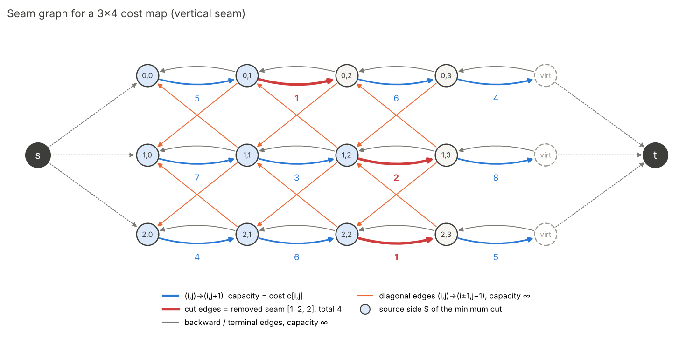
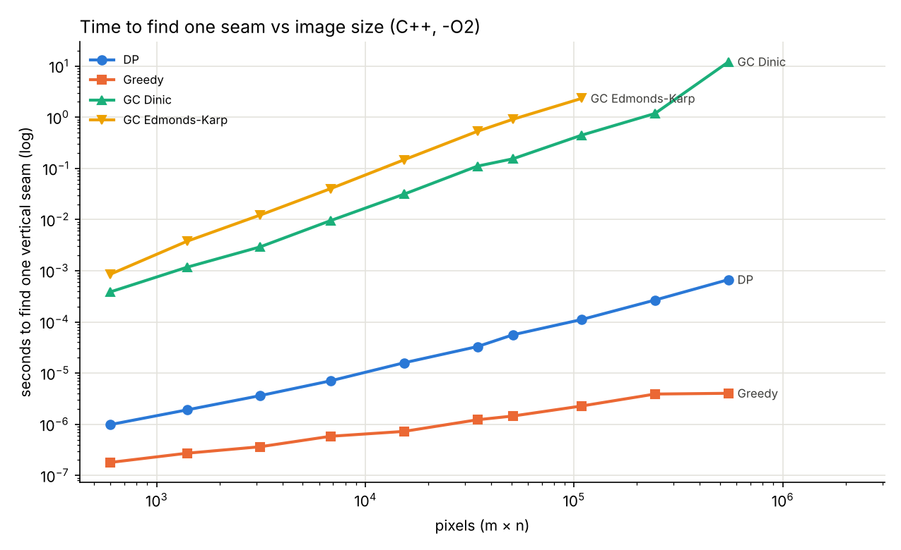
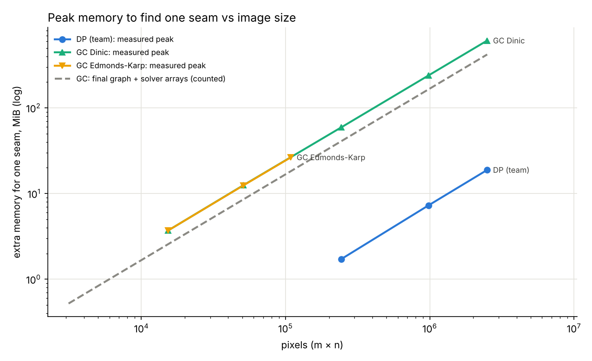
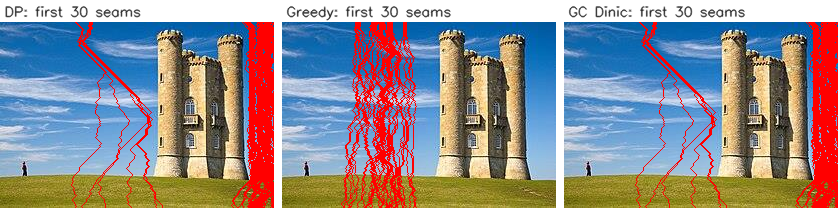
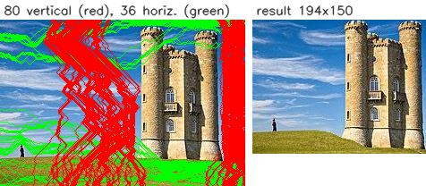

# Seam Carving by Graph Cut (min-cut / max-flow)

Item 4 of Assignment 2. Seam finding is reformulated as a minimum s–t cut and
solved with max-flow. **Dinic** and **Edmonds–Karp** are both implemented from
scratch in C++. OpenCV is used only for image I/O, `cvtColor` and `Sobel`; no
library resizing, graph or flow functions are used.

Every measurement in this README comes from the C++ programs below, in one run on
one machine (§2.0). Each table can be regenerated from the CSV files in
[`results/`](results) with `python tools/make_graphcut_tables.py`.

| File | Purpose |
|---|---|
| [`GraphCutting.h`](../../GraphCutting.h) / [`GraphCutting.cpp`](../../GraphCutting.cpp) | Flow network, Dinic, Edmonds–Karp, seam graph, vertical/horizontal seams, carve loop, seam overlay, energy |
| [`tests/GraphCuttingTests.cpp`](../../tests/GraphCuttingTests.cpp) | Correctness tests (2 073 checks) |
| [`tests/GraphCutVsTeamDPTests.cpp`](../../tests/GraphCutVsTeamDPTests.cpp) | Cross-check against the team's `DynamicProgramming.cpp` (6 474 checks) |
| [`tests/GraphCuttingBenchmark.cpp`](../../tests/GraphCuttingBenchmark.cpp) | Timing, Dinic phase, counted-memory, full-resize and visual-comparison experiments → [`results/`](results) |
| [`tests/GraphCuttingMemory.cpp`](../../tests/GraphCuttingMemory.cpp) + [`tools/run_graphcut_memory.py`](../../tools/run_graphcut_memory.py) | Measured peak-memory experiment (§2.3) |
| [`tools/plot_graphcut_timing.py`](../../tools/plot_graphcut_timing.py) | Draws the timing chart from the benchmark CSV |
| [`tools/make_graphcut_tables.py`](../../tools/make_graphcut_tables.py) | Prints this README's measurement tables from the CSVs |

## Quick start

From the repository root. CMake installs OpenCV itself through vcpkg on the first
configure (needs git; the first run builds OpenCV once, later runs are cached).

```bash
# Windows (any shell, Visual Studio 2022 installed)
cmake --preset vs2022
cmake --build --preset vs2022-release --target gc_tests gc_vs_dp gc_bench gc_mem
out\build\vs2022\Release\gc_tests.exe     # 2073 checks passed, 0 failed
out\build\vs2022\Release\gc_vs_dp.exe     # 6474 checks passed, 0 failed
out\build\vs2022\Release\gc_bench.exe     # writes docs/GraphCutting/results/ (~3 min)

# Linux / macOS
cmake --preset unix-release
cmake --build --preset unix-release --target gc_tests gc_vs_dp gc_bench gc_mem
./out/build/unix-release/gc_tests
./out/build/unix-release/gc_vs_dp
./out/build/unix-release/gc_bench

python tools/plot_graphcut_timing.py
python tools/run_graphcut_memory.py out/build/unix-release/gc_mem   # measured peak memory (~3 min; see §2.3)
python tools/make_graphcut_tables.py           # print the README tables from the CSVs
```

Visual Studio: File > Open > Folder on the repository root, pick a configuration
(Release), and choose `gc_tests.exe` / `gc_vs_dp.exe` / `gc_bench.exe` as the
start-up item. Build in **Release**. The max-flow loop is much slower in Debug builds.

```cpp
#include "GraphCutting.h"

GraphCut::CarveStats st;
cv::Mat out = GraphCut::Carve(img, 220, 160,                        // new width, new height
                              GraphCut::MaxFlowAlgorithm::Dinic,    // or EdmondsKarp
                              GraphCut::EnergyType::Backward,       // or Forward (simplified, §1.4)
                              &st, /*recordSeams*/ true);
cv::imwrite("seams.png", GraphCut::DrawSeams(img, st));             // red = vertical, green = horizontal

GraphCut::SeamResult r = GraphCut::FindVerticalSeam(GraphCut::ComputeEnergy(img));  // r.seam[row] = col
```

---

## 1. Algorithm

### 1.1 Graph construction (vertical seam on an m × n cost map `c`)



* One node per pixel `(i, j)`, plus a **virtual column** `j = n`, plus a source
  `s` and a sink `t`. So **V = m(n+1) + 2**.

| Edge | Capacity | Role |
|---|---|---|
| `s → (i, 0)` | ∞ | first column is on the source side |
| `(i, n) → t` | ∞ | virtual column is on the sink side |
| `(i, j) → (i, j+1)` | `c[i][j]` | cutting it means "remove pixel (i, j)" |
| `(i, j+1) → (i, j)` | ∞ | backward edge, stored as the reverse arc of the forward edge |
| `(i, j) → (i−1, j−1)`, `(i, j) → (i+1, j−1)` | ∞ | diagonal edges, j = 1..n−1 |

* ∞ is `Σc + 1` as `int64`, larger than any finite cut, so every capacity is an
  exact integer.
* The number of arcs is `2·(2m + mn + 2(m−1)(n−1)) ≈ 6N` for N = mn.

**Why the virtual column.** In the construction from the brief, the last real
column is wired straight to `t`, so the cut can never fall to its right and the
last column could never be removed. With one extra sink-side column, every
column is removable and the set of possible seams is exactly the DP's.
`TestFirstAndLastColumnRemovable` checks this.

### 1.2 Why every finite cut is exactly one connected seam

Let S be the source side of a finite cut and `b_i` the rightmost S-node in row i.
A finite cut cuts no ∞ edge, which gives three properties:

1. **One pixel per row (backward edges).** If `(i, j+1) ∈ S` then `(i, j) ∈ S`.
   So row i of S is the prefix `{0..b_i}`, and exactly **one** forward edge per row
   is cut: `(i, b_i) → (i, b_i+1)`, with cost `c[i][b_i]`.
2. **Connected seam (diagonal edges).** `(i, b_i) ∈ S` forces `(i−1, b_i−1)` and
   `(i+1, b_i−1)` into S. So `b_{i−1} ≥ b_i − 1` and `b_{i+1} ≥ b_i − 1`, which
   together give `|b_i − b_{i+1}| ≤ 1`.
3. **Stays inside the image (terminal edges).** `s → (i,0)` gives `b_i ≥ 0`, and
   `(i,n) → t` gives `b_i ≤ n−1`.

Conversely, every 8-connected seam defines a cut that crosses no ∞ edge. Hence
**cut capacity = Σ c[i][b_i] = seam cost**. By the **max-flow min-cut theorem**,
max flow = min cut = optimal seam cost. `FindVerticalSeam` checks
`flow == seam cost` on every call and throws if they differ.

### 1.3 Steps per seam

1. Compute the energy (`ComputeEnergy`, `CV_32S`).
2. Build the CSR residual graph (`BuildSeamGraph`). The 2E arcs are laid out by a
   counting sort on their tail node.
3. Run max-flow (Dinic by default).
4. Find S with a DFS from `s` over arcs whose residual capacity is > 0 (`SourceSide`).
5. Read off the seam: `seam[i] = (number of S nodes in row i) − 1`, which is the
   rightmost S pixel.
6. Remove the seam and recompute the energy; repeat. Horizontal seams run the same
   code on the transposed image.

### 1.4 Energy

Both energies are **per-pixel** costs, placed on the forward edge `(i, j) → (i, j+1)`.

* **Backward** (default): `e[i][j] = |Gx| + |Gy|`, using a 3×3 Sobel filter on the
  grayscale image with reflected borders.
* **Simplified forward** (`EnergyType::Forward`): `c[i][j] = |I[i][j+1] − I[i][j−1]|`,
  the cost given in the brief, on the grayscale image. It measures only the new
  **horizontal** neighbour pair created when `(i, j)` is removed and its left and
  right neighbours meet.

**What this is not.** It is not the full forward energy of Rubinstein, Shamir &
Avidan (2008). In the full version the cost of a seam pixel depends on how the
seam arrives from the row above:

| Seam step into (i, j) | Full forward cost | Our simplified cost |
|---|---|---|
| from (i−1, j−1) | `C_L = \|I(i,j+1) − I(i,j−1)\| + \|I(i−1,j) − I(i,j−1)\|` | `\|I(i,j+1) − I(i,j−1)\|` |
| from (i−1, j) | `C_U = \|I(i,j+1) − I(i,j−1)\|` | same |
| from (i−1, j+1) | `C_R = \|I(i,j+1) − I(i,j−1)\| + \|I(i−1,j) − I(i,j+1)\|` | `\|I(i,j+1) − I(i,j−1)\|` |

The extra terms are the new **vertical** neighbour pairs created when the seam
moves diagonally. Our version charges `C_U` for every step, so it ignores them
and under-counts the damage of diagonal seams. The practical consequences:

* Results labelled "forward" in this README and in the program use the
  simplified cost. They are not a reproduction of the paper's forward-energy
  results.
* Because the simplified cost is per-pixel, it goes on the same forward edge as
  the backward energy and needs no change to the graph. The full version is
  transition-dependent, so its costs go on arcs between rows. The paper builds
  that graph, mainly to handle video.
* The full forward energy for a **still image** does not need graph cut. The
  paper gives a DP recurrence for it:
  `M(i,j) = min(M(i−1,j−1) + C_L, M(i−1,j) + C_U, M(i−1,j+1) + C_R)`.
* The tests confirm GC = DP for both energies **as implemented here**: backward
  and simplified forward.

### 1.5 Max-flow solvers

Both solvers work on a **CSR (compressed sparse row)** residual graph. The arcs of
node u are `start[u] .. start[u+1]−1`, with flat arrays `to`, `cap` and `rev`
(`rev` gives the paired reverse arc). Pushing f units along arc a means
`cap[a] −= f; cap[rev[a]] += f`.

* **Edmonds–Karp.** BFS for the shortest augmenting path, push its bottleneck,
  repeat. Every augmentation pays for a full O(E) BFS.
* **Dinic.** One BFS builds the *level graph*. A **blocking flow** is then sent
  with an iterative DFS that uses:
  * current-arc pointers `it[u]`, so no arc is rescanned within a phase;
  * a retreat to the first saturated arc after each augmentation, instead of
    restarting from s;
  * dead-end pruning, which removes a node from the level graph.

  The phase repeats until t is unreachable. The DFS is iterative because seam
  paths are thousands of nodes long.

**Ties.** The S found from the residual graph is the *minimal* minimum cut. It is
unique, and the same whatever max flow is found, so graph cut always returns the
**leftmost** optimal seam, whichever solver is used. The tests confirm this: on
400 random cost maps, Dinic and Edmonds–Karp both return exactly the team DP's
leftmost seam (§3.1).

---

## 2. Complexity

N = mn pixels, V ≈ N, E ≈ 6N arcs.

| | Graph cut | DP |
|---|---|---|
| Build graph | O(N) | — |
| One seam, worst case | Edmonds–Karp **O(V·E²)**; Dinic **O(V²·E)**, both O(N³) | **O(N)** |
| One seam, integer-capacity bound † | O(E·F) = O(N·F) ⊆ O(N·m·c_max), F = max-flow value = optimal seam cost | — |
| Min-cut extraction | O(V + E) | backtrack O(m) |
| k seams | k × one seam | O(kN) |
| Space | O(N): 176 B/pixel counted, **256 B/pixel measured peak** (§2.3) | O(N): team DP **~8 B/pixel measured** (one 64-bit table) |

† **When the O(E·F) bound applies.** O(V·E²) for Edmonds–Karp and O(V²·E) for
Dinic hold for any non-negative real capacities. O(E·F) is a separate,
*pseudo-polynomial* bound. It needs all three of these conditions:

1. **Integer capacities.** Every augmenting path then pushes at least 1 unit, so
   there are at most F augmentations. With real-valued capacities the argument
   fails, and plain Ford–Fulkerson may not even terminate. Here every capacity is
   an integer: energies are `CV_32S`, and ∞ is the integer `Σc + 1`.
2. **Non-negative capacities.** `FindVerticalSeam` rejects negative costs.
3. **A finite max-flow value F.** The graph has "∞" arcs, so this is not
   automatic. It holds because a cut of finite capacity exists: any seam gives
   one. So F = optimal seam cost < `Σc + 1`. The bound depends on **F, not on
   ∞**: no augmenting path can carry more than the finite cut allows, so ∞ never
   enters the count.

**F grows with the image.** F is not a constant. It is at most the cost of any
single seam, so **F ≤ m · c_max**, where c_max is the largest per-pixel cost. For
8-bit images c_max is bounded: |Sobel_x| + |Sobel_y| ≤ 2·4·255 = 2 040 for the
backward energy, and 255 for the simplified forward energy. Hence:

* O(E·F) = O(N · m · c_max). This is polynomial in N **only because the bit
  depth is fixed**. In terms of input bit length, c_max is exponential, which is
  why the bound is called pseudo-polynomial.
* For a fixed aspect ratio, m = Θ(√N), so one seam costs **O(N^1.5)** for 8-bit
  images.

* **Edmonds–Karp:** at most F augmentations × O(E) BFS each, i.e. O(E·F).
* **Dinic:** at most F augmentations × ≤ V arcs per path, plus O(E) per phase over
  ≤ min(V, F) phases. That is O(F·V + min(V, F)·E) ⊆ O(E·F).

So one seam costs O(min(V·E², E·F)) with EK and O(min(V²·E, E·F)) with Dinic.
In practice F is far below its m · c_max ceiling: 2 446 for the tower, against
186 × 2 040 ≈ 380 000 and E ≈ 300 000. So the integer bound is far tighter than
O(N³). It also explains why runtime depends on the image (§2.1).

The measured exponents (Dinic N^1.63, EK N^1.47, §2.1) sit close to the N^1.5
ceiling. Treat that as consistent, not as proof:
* it is an upper bound;
* actual F is far below m · c_max;
* the largest sizes are slowed by other effects too (§2.2).

### 2.0 Measurement setup

| | |
|---|---|
| Machine | Cloud VM, 2 vCPU Intel Xeon @ 2.10 GHz, 7 GiB RAM, Ubuntu 24.04 |
| Compiler | g++ 13.3, `-std=c++14 -O2` |
| OpenCV | 4.6.0 |
| Images | `images/tower.png` (274×186) rescaled with `INTER_AREA` for the size sweeps; `images/synthetic.png` (180×120) |
| DP | the team's `DynamicProgramming.cpp` |
| Greedy | the team's `GreedyAlgorithm.cpp` |
| Run | all experiments on 17 Nov 2026: `gc_bench`, then `run_graphcut_memory.py` |

* **Timing method.** DP and Greedy times are the best of 5 runs. Graph-cut times
  are **single runs**, because they take up to minutes. The 600×407 Dinic seam
  took 1.18 s in the size sweep (§2.1) and 1.14 s in the phase experiment (§2.2)
  of this run; in an earlier run of the same code the two were 1.19 s and 1.39 s.
  Expect up to about **±15 % noise** on graph-cut times.
* **Read ratios and exponents, not absolute times.** Absolute times will differ
  on other machines, especially Windows Debug builds. Ratios and growth exponents
  are the meaningful results.

### 2.1 Running time vs image size

Time to find one vertical seam on the tower image, rescaled to increasing sizes
(`results/single_seam_timing.csv`). Energy computation is excluded; every
method receives the same cost map.



| Size | DP | Greedy | GC Dinic | GC Edmonds–Karp | Dinic / DP | EK / Dinic |
|---|---|---|---|---|---|---|
| 100×68 (6.8k px) | 0.007 ms | < 0.001 ms | 9.5 ms | 40.1 ms | ~1 350× | 4.2× |
| 274×186 (51.0k px) | 0.056 ms | 0.001 ms | 154.1 ms | 912.4 ms | ~2 750× | 5.9× |
| 400×272 (108.8k px) | 0.112 ms | 0.002 ms | 446.3 ms | 2 334.8 ms | ~4 000× | 5.2× |
| 600×407 (244.2k px) | 0.267 ms | 0.004 ms | 1 182.2 ms | — | ~4 400× | — |
| 900×611 (549.9k px) | 0.672 ms | 0.004 ms | 12 103 ms | — | ~18 000× | — |

Edmonds–Karp is not run above 400×272, where it would take minutes per seam.

Growth exponents, fitted between 100×68 and the largest size each method ran:

| Method | Measured growth | Theory |
|---|---|---|
| DP | **N^1.04** | O(N) |
| GC Dinic | **N^1.63** (up to 550k px) | O(N·m·c_max) = O(N^1.5) for 8-bit images (§2 †); O(N³) worst case |
| GC Edmonds–Karp | **N^1.47** (up to 109k px) | same |

Observations:

* **DP is linear**, as expected.
* **Greedy is effectively free.** It touches 3 pixels per row, O(m), so its time
  is at the limit of the timer.
* **Graph cut is superlinear.** Its exponent is far below the O(N³) worst case
  and close to the O(N^1.5) integer-capacity bound. Its gap to DP widens with
  size, from ~1 350× to ~18 000×.
* **Dinic is about 5× faster than Edmonds–Karp** (4.2–5.9×). Both make exactly
  the same number of augmentations on the tower (1 025, `results/seam_cost.csv`),
  but EK pays a full O(E) BFS for every one, while Dinic needs only 72 BFS phases.
* **Runtime depends on content, not just size.**
  * The tower's first seam has max-flow F = 2 446 and needs 1 025 augmentations.
  * The flat synthetic image has F = 328 and needs 76.
  * In the full resizes (§3.3), a graph-cut seam takes 17 ms on the synthetic
    image against 374 ms on the tower: 22× faster for an image only 2.4×
    smaller.

  This is the O(E·F) term at work. DP's time depends only on size.

### 2.2 Why graph cut slows sharply at large sizes

In the phase experiment below (`results/phase_scaling.csv`, one Dinic seam per
size), the time per seam jumps 10.7× from 600×407 to 900×611 for 2.25× more
pixels. In the size sweep of §2.1 the same jump is 10.2×. The table shows where
the time goes:

| Size | Arcs | Graph | Time | Phases | Augmentations | ms per phase |
|---|---|---|---|---|---|---|
| 274×186 | 304 692 | 8.5 MiB | 0.14 s | 72 | 1 025 | 1.9 |
| 400×272 | 651 204 | 18.2 MiB | 0.44 s | 107 | 1 286 | 4.1 |
| 600×407 | 1 462 804 | 41.0 MiB | 1.14 s | 127 | 1 465 | 8.9 |
| 750×509 | 2 287 504 | 64.0 MiB | 4.33 s | 214 | 1 617 | 20.2 |
| 900×611 | 3 295 804 | 92.2 MiB | 12.16 s | 315 | 1 569 | 38.6 |

Two effects multiply between 600 and 900 px wide:

* **More phases (2.5×), with almost the same number of augmentations.** Each
  Dinic phase can only use paths of one length. Each phase raises the source-to-sink
  distance, and a larger image has longer paths through the grid, so the same
  ~1 500 augmentations are spread over more BFS rounds.
* **More time per phase (4.3×) than the graph grows (2.25×).** A phase's BFS and
  DFS jump around the `level`, `cap` and `to` arrays almost at random. As the graph
  grows from 41 to 92 MiB, more of those accesses miss the CPU cache. DP's
  row-by-row scan, by contrast, reads memory in order.

  This is the likely explanation, but cache misses were **not measured** here.
  This VM also shares a large L3 cache with other tenants, so the size at which
  the effect starts will vary between machines.

### 2.3 Memory: counted and measured

There are two experiments. The first **counts** the bytes of the final data
structures. The second **measures** what the process actually uses. They differ,
and the difference is itself a result.

**(a) Counted size of the final data structures** (`gc_bench`,
`results/memory_usage.csv`). Graph cut counts the CSR arrays `start/to/cap/rev`
plus Dinic's `level/it/queue` arrays, all int64. The DP column counts the
**team's** `DynamicProgramming.cpp`, from the objects it actually allocates: the
cumulative table `M` (`CV_64F`, 8 bytes per pixel) plus the seam (one int per
row). The team DP backtracks the seam through `M`, so it stores no
back-pointers. The cost map is shared by all methods and excluded.

| Image | Nodes V | Arcs | Graph cut (counted) | Team DP (counted) | GC / DP |
|---|---|---|---|---|---|
| 68×46 | 3 176 | 18 500 | 0.52 MiB | 0.02 MiB | 22× |
| 150×102 | 15 404 | 91 204 | 2.56 MiB | 0.12 MiB | 22× |
| 274×186 | 51 152 | 304 692 | 8.53 MiB | 0.39 MiB | 22× |
| 600×407 | 244 609 | 1 462 804 | 40.95 MiB | 1.86 MiB | 22× |
| 1200×815 | 978 817 | 5 863 204 | 164.07 MiB | 7.46 MiB | 22× |
| 1920×1303 | 2 503 065 | 15 002 884 | 419.78 MiB | 19.09 MiB | 22× |

This gives **176 B/pixel** for the graph: ~6 arcs × 3 int64 fields = 144, plus
`start` (8) and the solver arrays (24). The team DP needs **8 B/pixel**, so
counted graph cut is 22× larger.

**(b) Measured peak memory** (`gc_mem` driven by `tools/run_graphcut_memory.py`,
`results/memory_peak.csv`):

* One seam is found per **fresh process**, on the tower image rescaled to each
  size.
* Before the seam, the program frees setup memory back to the OS (`malloc_trim`)
  and resets the kernel's resident-memory high-water mark (`/proc/self/clear_refs`).
* The reported value is **peak resident memory during the seam − resident memory
  just before it**. That is the extra memory the seam finder needs, including
  temporaries and allocator overhead.
* DP here is the **team's** `DynamicProgramming.cpp`.
* Rows under 1 MiB are at the limit of what can be measured (4 KiB pages, heap
  bookkeeping). They are flagged in the CSV and left out of the per-pixel figures.



| Image | GC Dinic peak | GC EK peak | Team DP peak | GC / DP |
|---|---|---|---|---|
| 150×102 | 3.70 MiB (253 B/px) | 3.70 MiB | < 1 MiB | — |
| 274×186 | 12.50 MiB (257 B/px) | 12.43 MiB | < 1 MiB | — |
| 600×407 | 59.41 MiB (255 B/px) | — | 1.72 MiB (7 B/px) | 34× |
| 1200×815 | 238.45 MiB (256 B/px) | — | 7.26 MiB (8 B/px) | 33× |
| 1920×1303 | **610.36 MiB** (256 B/px) | — | 18.86 MiB (8 B/px) | 32× |

Edmonds–Karp was also measured at 400×272 (26.46 MiB, 255 B/px). It is not run
at the larger sizes because of its running time.

What the measurements show:

* **The real peak is 256 B/pixel, 45 % above the counted 176.** The extra memory
  is the **temporary edge list** in `BuildSeamGraph`. While the CSR graph is being
  filled, three things are alive at once:
  * the list of ~3N logical edges, `{from, to, cap, revCap}` × int64 = 96 B/pixel;
  * the finished CSR arrays, 152 B/pixel;
  * the counting-sort cursor `next`, 8 B/pixel.

  That adds up to 96 + 152 + 8 = **256 B/pixel**, matching the measurement to
  within 1 B/pixel from 274×186 upwards. The edge list is freed before max-flow
  starts, so the peak happens during **construction**, not during the solve.
* **Dinic and Edmonds–Karp use the same memory.** They share the graph and the
  build-time peak. Their extra work arrays (Dinic `level/it/queue`, 24 B/px; EK
  `parentArc/queue`, 16 B/px) fit inside the peak the edge list already set.
* **Memory is linear in N for both methods.** The per-pixel cost is constant
  from 150×102 to 1920×1303. Measured, graph cut needs about **32–34×** the team
  DP's memory. That is more than the counted 22×, because graph cut's temporary
  edge list adds to its peak. A full-HD frame needs about 610 MiB for one seam.
* **The team DP matches its count.** It measures 7–8 B/pixel against the counted
  8.0. The measured values sit a steady ~0.2 MiB below the count at every size
  (1.72 vs 1.86, 7.26 vs 7.46, 18.86 vs 19.09 MiB). That gap is within the
  probe's resolution, so the per-pixel figure is closest to the count at the
  largest size (7.9 B/pixel). Unlike graph cut, DP has no hidden temporary: its
  one table is both its final structure and its peak.
* **Platform.** Measured on Linux (glibc, `/proc/self/status`). The probe also
  builds on Windows (`PeakWorkingSetSize`), but the peak cannot be reset there,
  and those numbers have not been checked.

---

## 3. Results

### 3.1 Optimality: graph cut ≡ DP

| Check | Source | Result |
|---|---|---|
| 300 random cost maps per solver (1–11 × 1–11), Dinic and EK | `gc_tests` | GC cost = DP cost in every case |
| 200 random flow networks | `gc_tests` | Dinic = Edmonds–Karp |
| Team DP: energy maps, 22 images | `gc_vs_dp` | identical to `GraphCut::ComputeEnergy`, backward and simplified forward |
| Team DP: 400 random cost maps (1–14 × 1–14), Dinic and EK, vertical and horizontal | `gc_vs_dp` | GC cost = DP cost and GC seam = DP seam in every case; every GC seam accepted by `DP::SeamEnergy` |
| Team DP: `GraphCut::Carve` vs `DP::Carve` (5 runs, both energies, up to 274×186) | `gc_vs_dp` | equal seam cost at every step, identical seams, pixel-identical output |
| First seam, tower | `seam_cost.csv` | DP 2 446 · **GC 2 446** · Greedy 7 494 |
| First seam, synthetic | `seam_cost.csv` | DP 328 · **GC 328** · Greedy 344 |
| 80-seam carve, tower | `gc_bench` | 80/80 seams identical to DP |
| 50-seam carve, synthetic | `gc_bench` | 50/50 seams identical to DP |

The seams are identical, not just equal in cost, because graph cut and both DPs
all prefer the leftmost seam on ties (§1.5). With a different DP tie-break, the
costs would still be equal, but the seams could differ.

### 3.2 Visual quality

DP, Greedy and graph cut each remove 80 vertical seams from the tower
(274×186 → 194×186):


The first 30 seams of each method, in red:



* **DP and graph cut give the same image.** Their seams run through the sky and
  the grass, and keep the tower and the person intact.
* **Greedy distorts the tower.** It commits to the locally cheapest pixel in each
  row and cannot see ahead. Its first 30 seams all fall into one narrow band of
  sky left of the tower, instead of spreading over the cheap regions as DP's do.
  Once that band is used up, later seams have to cut through the tower, which
  ends up visibly narrower. Its total removed energy is about 2.1× the optimum
  (900 958 vs 430 676).

The same comparison for the synthetic image is in
[`results/compare_synthetic.png`](results/compare_synthetic.png) and
[`results/seams_synthetic.png`](results/seams_synthetic.png).

Graph cut shrinking the tower in both directions (274×186 → 194×150: 80 vertical
seams in red, then 36 horizontal seams in green):



This took 40.1 s, with a total removed energy of 668 244
(`results/both_directions.csv`). The tower and the person are kept. The
horizontal seams come mostly out of the sky and the grass, which skews the slope
of the hill slightly.

### 3.3 Full resize time

`results/full_resize.csv`. Times include recomputing the energy after every
seam:

| Image | Seams removed | DP | Greedy | GC Dinic | GC per seam | Total energy removed: DP / Greedy / GC |
|---|---|---|---|---|---|---|
| tower 274×186 | 80 vertical | 0.018 s | 0.015 s | 29.96 s | 374 ms | 430 676 / 900 958 / 430 676 |
| synthetic 180×120 | 50 vertical | 0.005 s | 0.004 s | 0.86 s | 17 ms | 16 400 / 40 212 / 16 400 |

Graph cut is about **1 700×** slower than DP over the tower resize, for the same
result.

---

## 4. Discussion

* **Same answer, much higher cost.** For the plain seam problem, DP and graph cut
  are both exact and return the same optimum. DP exploits the seam's row-by-row
  structure: each row depends only on the row above, so the problem splits into
  O(N) subproblems. Graph cut ignores that structure and solves a general flow
  problem. Measured, one seam grows like N^1.4–1.6 (§2.1), close to the
  O(N·m·c_max) bound in §2. It is about 2 750× slower than DP on the 274×186
  image and needs 32–34× more memory (§2.3). Its general worst-case bound is
  O(N³).
* **Why graph cut is still worth knowing.** It can express constraints DP cannot.
  * It extends to **video**, where a seam becomes a surface through a 3-D volume
    and row-by-row DP no longer applies (Rubinstein, Shamir & Avidan, 2008). That
    paper puts the full forward energy on the graph's arcs for this case.
  * For still images the full forward energy does **not** need graph cut: it is a
    DP with transition costs (§1.4). We implement only the simplified per-pixel
    version, so the full version, in either form, is a natural extension rather
    than something this project shows.
  * It is the standard tool for image segmentation.
* **Greedy** is the fastest but not optimal: its cumulative cost is about 2× (tower)
  to 2.5× (synthetic) the optimum, with visible distortion (§3.2).

### Improvements

* **Better solver for grid graphs.** Boykov–Kolmogorov keeps its search trees
  between augmentations and is the standard choice for vision graphs.
  Push–relabel is another option.
* **Warm start.** Removing one seam only changes the graph near that seam, so
  the previous flow could be repaired instead of recomputed from zero.
* **Build the CSR graph directly.** The grid's structure is known, so every
  node's arcs can be written straight into the CSR arrays with no intermediate
  edge list. That lowers the measured peak from 256 to about 176 B/pixel (§2.3),
  with no change to the result.
* **Cache and memory.** int32 arrays would halve the 176 B/pixel, since all
  capacities fit in 32 bits once ∞ is clamped. The node order could also be
  improved for locality. Reusing one preallocated graph and only updating its
  capacities would avoid rebuilding it for every seam.
* **Multithreading.** Dinic's BFS can be parallelised level by level, and
  push–relabel parallelises well. The outer loop cannot be: each seam depends on
  the previous removal. The independent experiments, such as the three methods or
  different images, can run in parallel.
* **Band restriction.** Searching only a band around the previous seam shrinks
  the graph, but gives up guaranteed optimality.

### Note on the earlier prototype

This code was ported from an earlier Python prototype. That prototype is not in
the repository, so none of its figures are reported here; every number above
comes from the C++ code.

## References

* S. Avidan, A. Shamir. *Seam Carving for Content-Aware Image Resizing.* SIGGRAPH 2007.
* M. Rubinstein, A. Shamir, S. Avidan. *Improved Seam Carving for Video Retargeting.* SIGGRAPH 2008.
* E. A. Dinic. *Algorithm for solution of a problem of maximum flow in networks with power estimation.* 1970.
* J. Edmonds, R. M. Karp. *Theoretical improvements in algorithmic efficiency for network flow problems.* JACM 1972.
* Y. Boykov, V. Kolmogorov. *An experimental comparison of min-cut/max-flow algorithms for energy minimization in vision.* PAMI 2004.
* T. Cormen et al. *Introduction to Algorithms*, Ch. 26 (max-flow example used in the tests).
