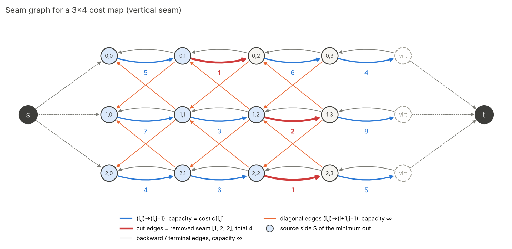
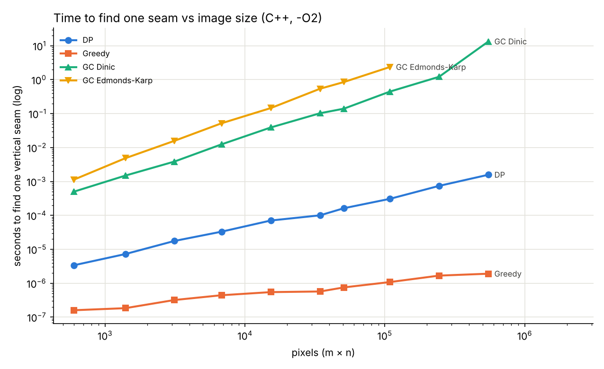
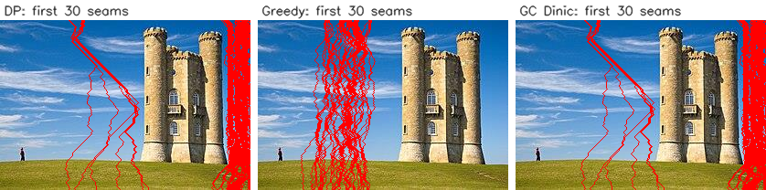
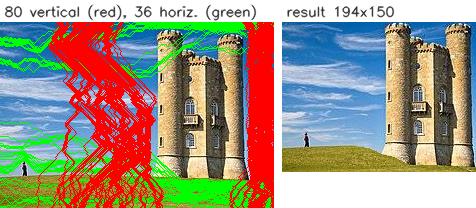

# Seam Carving by Graph Cut (min-cut / max-flow)

Item 4 of Assignment 2. Seam finding is reformulated as a minimum s–t cut and
solved with max-flow. **Dinic** and **Edmonds–Karp** are both implemented from
scratch in C++. OpenCV is used only for image I/O, `cvtColor` and `Sobel`; no
library resizing, graph or flow functions are used.

| File | Purpose |
|---|---|
| [`GraphCutting.h`](../../GraphCutting.h) / [`GraphCutting.cpp`](../../GraphCutting.cpp) | Flow network, Dinic, Edmonds–Karp, seam graph, vertical/horizontal seams, carve loop, seam overlay, energy |
| [`tests/GraphCuttingTests.cpp`](../../tests/GraphCuttingTests.cpp) | Correctness tests (2 060 checks) |
| [`tests/GraphCuttingBenchmark.cpp`](../../tests/GraphCuttingBenchmark.cpp) | Timing, memory and visual-comparison experiments → [`results/`](results) |
| [`tools/plot_graphcut_timing.py`](../../tools/plot_graphcut_timing.py) | Draws the timing chart from the benchmark CSV |

## Quick start

```bash
# from the repository root, OpenCV 4 installed
g++ -std=c++14 -O2 -I. tests/GraphCuttingTests.cpp     GraphCutting.cpp -o gc_tests `pkg-config --cflags --libs opencv4`
g++ -std=c++14 -O2 -I. tests/GraphCuttingBenchmark.cpp GraphCutting.cpp -o gc_bench `pkg-config --cflags --libs opencv4`
./gc_tests                          # 2060 checks passed, 0 failed
./gc_bench                          # writes docs/GraphCutting/results/ (~2 min)
python tools/plot_graphcut_timing.py
```

Visual Studio: add the `.cpp` files to a project with the usual OpenCV include and
lib settings, and build in **Release**. The max-flow loop is much slower in Debug
builds.

```cpp
#include "GraphCutting.h"

GraphCut::CarveStats st;
cv::Mat out = GraphCut::Carve(img, 220, 160,                        // new width, new height
                              GraphCut::MaxFlowAlgorithm::Dinic,    // or EdmondsKarp
                              GraphCut::EnergyType::Backward,       // or Forward
                              &st, /*recordSeams*/ true);
cv::imwrite("seams.png", GraphCut::DrawSeams(img, st));             // red = vertical, green = horizontal

GraphCut::SeamResult r = GraphCut::FindVerticalSeam(GraphCut::ComputeEnergy(img));  // r.seam[row] = col
```

---

## 1. Algorithm

### 1.1 Graph construction (vertical seam on an m × n cost map `c`)



* One node per pixel `(i, j)`, plus a **virtual column** `j = n`, plus a source
  `s` and a sink `t`. So **V = m(n+1) + 2**.

| Edge | Capacity | Role |
|---|---|---|
| `s → (i, 0)` | ∞ | first column is on the source side |
| `(i, n) → t` | ∞ | virtual column is on the sink side |
| `(i, j) → (i, j+1)` | `c[i][j]` | cutting it means "remove pixel (i, j)" |
| `(i, j+1) → (i, j)` | ∞ | backward edge, stored as the reverse arc of the forward edge |
| `(i, j) → (i−1, j−1)`, `(i, j) → (i+1, j−1)` | ∞ | diagonal edges, j = 1..n−1 |

* ∞ is `Σc + 1` as `int64`, larger than any finite cut, so every capacity is an
  exact integer.
* The number of arcs is `2·(2m + mn + 2(m−1)(n−1)) ≈ 6N` for N = mn.

**Why the virtual column.** In the construction from the brief, the last real
column is wired straight to `t`, so the cut can never fall to its right and the
last column could never be removed. With one extra sink-side column, every
column is removable and the set of possible seams is exactly the DP's.
`TestFirstAndLastColumnRemovable` checks this.

### 1.2 Why every finite cut is exactly one connected seam

Let S be the source side of a finite cut and `b_i` the rightmost S-node in row i.
A finite cut cuts no ∞ edge, which gives three properties:

1. **One pixel per row (backward edges).** If `(i, j+1) ∈ S` then `(i, j) ∈ S`.
   So row i of S is the prefix `{0..b_i}`, and exactly **one** forward edge per row
   is cut: `(i, b_i) → (i, b_i+1)`, with cost `c[i][b_i]`.
2. **Connected seam (diagonal edges).** `(i, b_i) ∈ S` forces `(i−1, b_i−1)` and
   `(i+1, b_i−1)` into S. So `b_{i−1} ≥ b_i − 1` and `b_{i+1} ≥ b_i − 1`, which
   together give `|b_i − b_{i+1}| ≤ 1`.
3. **Stays inside the image (terminal edges).** `s → (i,0)` gives `b_i ≥ 0`, and
   `(i,n) → t` gives `b_i ≤ n−1`.

Conversely, every 8-connected seam defines a cut that crosses no ∞ edge. Hence
**cut capacity = Σ c[i][b_i] = seam cost**. By the **max-flow min-cut theorem**,
max flow = min cut = optimal seam cost. `FindVerticalSeam` checks
`flow == seam cost` on every call and throws if they differ.

### 1.3 Steps per seam

1. Compute the energy (`ComputeEnergy`, `CV_32S`).
2. Build the CSR residual graph (`BuildSeamGraph`). The 2E arcs are laid out by a
   counting sort on their tail node.
3. Run max-flow (Dinic by default).
4. Find S with a DFS from `s` over arcs whose residual capacity is > 0 (`SourceSide`).
5. Read off the seam: `seam[i] = (number of S nodes in row i) − 1`, which is the
   rightmost S pixel.
6. Remove the seam and recompute the energy; repeat. Horizontal seams run the same
   code on the transposed image.

### 1.4 Energy

Both energies are **per-pixel** costs, placed on the forward edge `(i, j) → (i, j+1)`.

* **Backward** (default): `e[i][j] = |Gx| + |Gy|`, using a 3×3 Sobel filter on the
  grayscale image with reflected borders.
* **Simplified forward** (`EnergyType::Forward`): `c[i][j] = |I[i][j+1] − I[i][j−1]|`,
  the cost given in the brief. It measures the new intensity edge created when
  `(i, j)` is removed and its left and right neighbours meet.

This is **not** the full forward energy of Rubinstein et al. (2008). There, the
cost depends on the seam's transition between rows (left, straight or right), so
it sits on the diagonal and vertical edges rather than on pixels. Because our
costs are per-pixel, DP can solve exactly the same problem, and the tests confirm
GC = DP for both energies.

### 1.5 Max-flow solvers

Both solvers work on a **CSR (compressed sparse row)** residual graph. The arcs of
node u are `start[u] .. start[u+1]−1`, with flat arrays `to`, `cap` and `rev`
(`rev` gives the paired reverse arc). Pushing f units along arc a means
`cap[a] −= f; cap[rev[a]] += f`.

* **Edmonds–Karp.** BFS for the shortest augmenting path, push its bottleneck,
  repeat. Every augmentation pays for a full O(E) BFS.
* **Dinic.** One BFS builds the *level graph*. A **blocking flow** is then sent
  with an iterative DFS that uses:
  * current-arc pointers `it[u]`, so no arc is rescanned within a phase;
  * a retreat to the first saturated arc after each augmentation, instead of
    restarting from s;
  * dead-end pruning, which removes a node from the level graph.

  The phase repeats until t is unreachable. The DFS is iterative because seam
  paths are thousands of nodes long.

**Ties.** The S found from the residual graph is the *minimal* minimum cut. It is
unique, and the same whatever max flow is found, so graph cut always returns the
**leftmost** optimal seam. The Python prototype took a different number of
augmentations (1 030 vs 1 025), because it stores arcs in a different order, yet
produced pixel-identical output.

---

## 2. Complexity

N = mn pixels, V ≈ N, E ≈ 6N arcs.

| | Graph cut | DP |
|---|---|---|
| Build graph | O(N) | — |
| One seam, worst case | Edmonds–Karp **O(V·E²)**; Dinic **O(V²·E)**, both O(N³) | **O(N)** |
| One seam, integer-capacity bound † | O(E·F) = O(N·F), F = max-flow value = optimal seam cost | — |
| Min-cut extraction | O(V + E) | backtrack O(m) |
| k seams | k × one seam | O(kN) |
| Space | O(N), **measured 176 B/pixel** (§2.2) | O(N), 12 B/pixel (int64 table + int back-pointers) |

† **When the O(E·F) bound applies.** O(V·E²) and O(V²·E) hold for any
capacities. O(E·F) is a separate, *pseudo-polynomial* bound that needs integer
capacities. It holds here because every capacity is an integer, so every
augmentation pushes at least 1 unit and there are at most F augmentations.

* **Edmonds–Karp:** at most F augmentations × O(E) BFS each, i.e. O(E·F).
* **Dinic:** at most F augmentations × ≤ V arcs per path, plus O(E) per phase over
  ≤ min(V, F) phases. That is O(F·V + min(V, F)·E) ⊆ O(E·F).

So one seam costs O(min(V·E², E·F)) with EK and O(min(V²·E, E·F)) with Dinic.
F is small (2 446 for the tower versus E ≈ 300 000), so the integer bound is far
tighter than O(N³), and it explains why runtime depends on the image (§2.1).

### 2.1 Measured running time

Time to find one vertical seam on the tower image, rescaled to increasing sizes
(`results/single_seam_timing.csv`, C++ `-O2`, best of 5 runs for DP and Greedy,
one run for graph cut):



| Size | DP | Greedy | GC Dinic | GC Edmonds–Karp | Dinic / DP |
|---|---|---|---|---|---|
| 100×68 (6.8k px) | 0.033 ms | < 0.01 ms | 12.4 ms | 52 ms | ~380× |
| 274×186 (51k px) | 0.163 ms | < 0.01 ms | 140 ms | 853 ms | ~860× |
| 400×272 (109k px) | 0.308 ms | < 0.01 ms | 447 ms | 2 371 ms | ~1 450× |
| 600×407 (244k px) | 0.741 ms | < 0.01 ms | 1 218 ms | — | ~1 640× |
| 900×611 (550k px) | 1.578 ms | < 0.01 ms | 13 408 ms | — | ~8 500× |

Observations:

* **DP grows linearly.** It measures about N^0.9, matching O(N).
* **Greedy is effectively free.** It touches only 3 pixels per row, O(m), so
  its time is at the limit of what the timer can measure.
* **Graph cut grows superlinearly.** Up to 244k px, Dinic grows about **N^1.3**
  (EK about N^1.4). That is far below the O(N³) worst case, but the gap to DP
  widens with size.
* **The jump at 900×611 is real and reproducible** (13.3 s and 13.6 s in
  re-runs). Two effects multiply:

  | Width | Dinic phases | ms per phase |
  |---|---|---|
  | 600 | 127 | 9 |
  | 750 | 214 | 20 |
  | 900 | 315 | 43 |

  The number of phases (BFS rounds) grows because the shortest augmenting paths
  get longer on larger images. The time per phase grows 4.7× while the arc count
  grows only 2.25×. The graph is about 41 MiB at 600 px and about 92 MiB at
  900 px, which no longer fits in the CPU cache, and the BFS/DFS access the
  `level` and `cap` arrays almost at random. **Graph cut is memory-bound at large
  sizes**; DP's row-by-row scan is cache-friendly.
* **Dinic vs Edmonds–Karp.** Dinic is 4–6× faster on the larger images. Both do
  exactly the same number of augmentations (1 025 on the tower), but EK pays a
  full BFS per augmentation, while Dinic needs only 72 BFS phases.
* **Runtime depends on content.** The tower's first seam has F = 2 446 and needs
  1 025 augmentations. The flat synthetic image has F = 328 and needs only 76. Per
  seam, the synthetic image takes ~17 ms against the tower's ~400 ms: 23× faster
  for an image only 2.4× smaller. This is the O(E·F) term at work. DP's time
  depends only on size.

### 2.2 Measured memory

The data structures for one seam are counted exactly (`results/memory_usage.csv`).
Graph cut counts the CSR arrays `start/to/cap/rev` plus Dinic's `level/it/queue`
arrays, all int64. DP counts the cumulative table (int64) plus back-pointers
(int). The cost map is shared by all methods and is excluded.

| Image | Nodes V | Arcs | Graph cut | DP |
|---|---|---|---|---|
| 68×46 | 3 176 | 18 500 | 0.52 MiB | 0.04 MiB |
| 274×186 | 51 152 | 304 692 | 8.53 MiB | 0.58 MiB |
| 600×407 | 244 609 | 1 462 804 | 40.95 MiB | 2.79 MiB |
| 1200×815 | 978 817 | 5 863 204 | 164.07 MiB | 11.19 MiB |
| 1920×1303 | 2 503 065 | 15 002 884 | 419.78 MiB | 28.63 MiB |

Both grow linearly. Graph cut stays at about **176 B/pixel** at every size,
roughly 15× DP's 12 B/pixel: each pixel owns ~6 arcs × 3 int64 fields. At
full-HD size the graph alone is about 420 MiB.

---

## 3. Results

### 3.1 Optimality: graph cut ≡ DP

| Check | Result |
|---|---|
| 600 random cost maps (1–11 × 1–11), Dinic and EK | GC cost = DP cost in every case |
| 200 random flow networks | Dinic = Edmonds–Karp |
| First seam, tower | DP 2 446 · **GC 2 446** · Greedy 7 686 |
| First seam, synthetic | DP 328 · **GC 328** · Greedy 344 |
| 80-seam carve, tower | GC cost = DP cost at **80/80** steps; 80/80 seams identical |
| 50-seam carve, synthetic | 50/50 seams identical |
| Cumulative cost, 80 seams (tower) | DP 430 676 · **GC 430 676** · Greedy 882 264 |
| Cumulative cost, 50 seams (synthetic) | DP 16 400 · **GC 16 400** · Greedy 40 924 |
| C++ vs Python prototype, tower 274×186 → 194×150 | output images pixel-identical, total cost 668 244 in both |

The seams are identical because both GC and the reference DP prefer the leftmost
seam on ties. With a different DP tie-break, the costs would still be equal, but
the seams could differ.

### 3.2 Visual quality




DP and graph cut produce the same picture: the seams run through the sky and
the grass, and the tower and the person are kept intact. Greedy commits to the
locally cheapest pixel in each row and cannot see ahead, so its seams wander into
the tower and visibly squash it. Its cumulative cost is about 2× higher.



Shrinking in both directions (80 vertical + 36 horizontal seams, 42 s) keeps
the tower and the person. The horizontal seams come mostly out of the sky and the
grass, which skews the slope of the hill slightly.

### 3.3 Full resize time

| Image | Seams removed | DP | Greedy | GC Dinic |
|---|---|---|---|---|
| tower 274×186 | 80 vertical | 0.026 s | 0.016 s | 31.9 s |
| synthetic 180×120 | 50 vertical | 0.006 s | 0.004 s | 0.86 s |

These times include recomputing the energy after every seam.

---

## 4. Discussion

* **Same answer, much higher cost.** For the plain seam problem, DP and graph cut
  are both exact and return the same optimum. DP exploits the seam's row-by-row
  structure: each row depends only on the row above, so the problem splits into
  O(N) subproblems. Graph cut ignores that structure and solves a general flow
  problem. In practice it grows like N^1.3 or worse and becomes memory-bound, and
  its worst case is O(N³).
* **Why graph cut is still worth knowing.** It can express constraints DP cannot.
  * Costs can sit on *edges* rather than pixels, which the full,
    transition-dependent forward energy requires. We implement only the simplified
    per-pixel version (§1.4), so the full version is a natural extension.
  * It extends to **video**, where a seam becomes a surface through a 3-D volume
    and row-by-row DP no longer applies (Rubinstein, Shamir & Avidan, 2008).
  * It is the standard tool for image segmentation.
* **Greedy** is the fastest but not optimal: its cumulative cost is 2× (tower) to
  2.5× (synthetic) higher, with visible distortion.

### Improvements

* **Implementation language.** Our first prototype ran the same Dinic in pure
  Python and took 8.1 s per seam on the tower, against 0.14 s in C++ (~58×).
  Graph traversal can't be vectorised, so it is very sensitive to interpreter
  overhead.
* **Better solver for grid graphs.** Boykov–Kolmogorov keeps its search trees
  between augmentations and is the standard choice for vision graphs.
  Push–relabel is another option.
* **Warm start.** Removing one seam only changes the graph near that seam, so
  the previous flow could be repaired instead of recomputed from zero.
* **Cache and memory.** int32 arrays would halve the 176 B/pixel, since all
  capacities fit in 32 bits once ∞ is clamped. The node order could also be
  improved for locality. Reusing one preallocated graph and only updating its
  capacities would avoid rebuilding it for every seam.
* **Multithreading.** Dinic's BFS can be parallelised level by level, and
  push–relabel parallelises well. The outer loop cannot be: each seam depends on
  the previous removal. The independent experiments, such as the three methods or
  different images, can run in parallel.
* **Band restriction.** Searching only a band around the previous seam shrinks
  the graph, but gives up guaranteed optimality.

## References

* S. Avidan, A. Shamir. *Seam Carving for Content-Aware Image Resizing.* SIGGRAPH 2007.
* M. Rubinstein, A. Shamir, S. Avidan. *Improved Seam Carving for Video Retargeting.* SIGGRAPH 2008.
* E. A. Dinic. *Algorithm for solution of a problem of maximum flow in networks with power estimation.* 1970.
* J. Edmonds, R. M. Karp. *Theoretical improvements in algorithmic efficiency for network flow problems.* JACM 1972.
* Y. Boykov, V. Kolmogorov. *An experimental comparison of min-cut/max-flow algorithms for energy minimization in vision.* PAMI 2004.
* T. Cormen et al. *Introduction to Algorithms*, Ch. 26 (max-flow example used in the tests).
