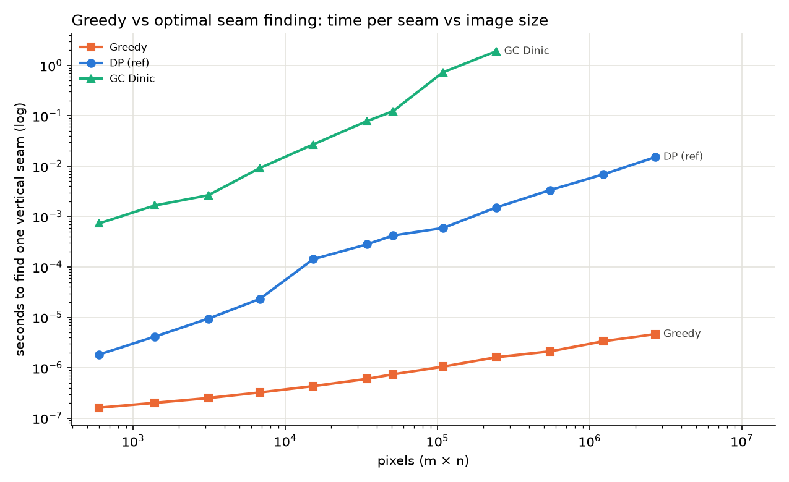
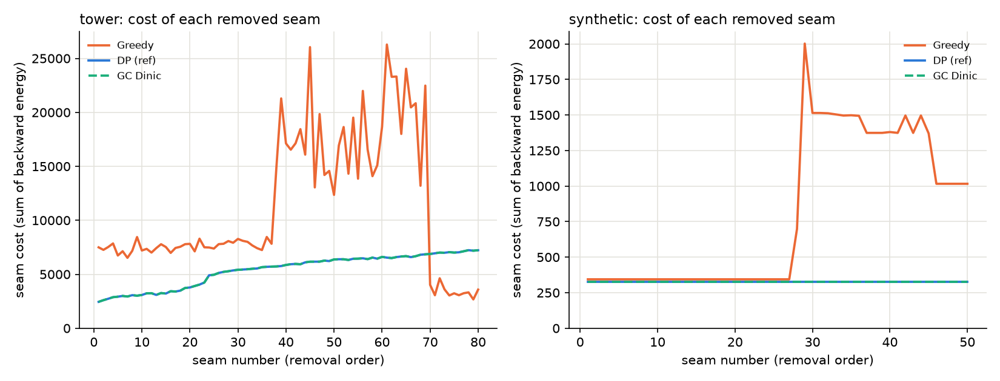
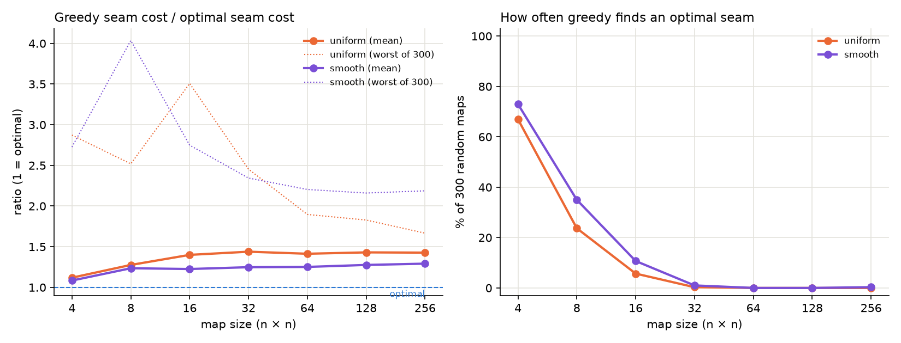
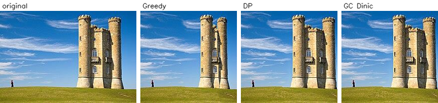
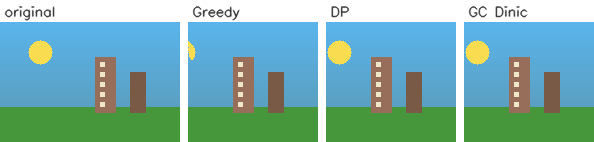
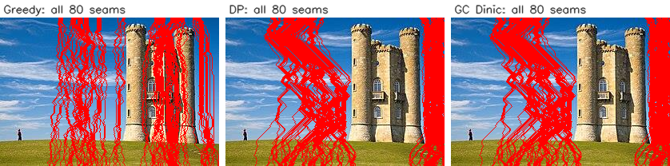
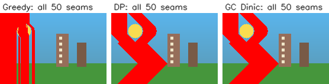
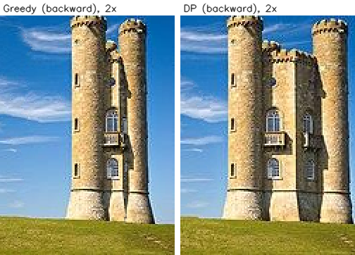
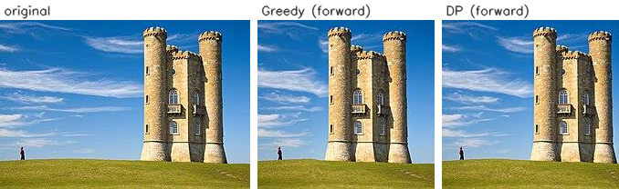
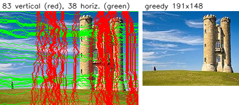

# Seam Carving by a Greedy Algorithm

Item 3 of Assignment 2. Instead of the globally optimal seam that dynamic
programming (DP) finds, the greedy algorithm builds the seam with a **local,
row-by-row decision**. It starts at the cheapest pixel of the first row and, in
each following row, steps to the cheapest of the three pixels below. This
report answers the question in the brief: *does greedy give results comparable
to DP in visual quality?* It also compares the seams, the visual quality and
the running time of the two methods.

**Short answer: no.** Greedy is 70–3 000× faster at *finding* a seam
(100×68 up to 2000×1358 pixels). It
finds an optimal seam only by luck, though, and is often 2–3× worse
(48× with the forward energy on the tower). Its seams cut through the towers
and the sun, where DP's go around them. The speed-up also nearly disappears in
a full resize, because recomputing the energy map and removing the seam cost
O(mn) per seam for both methods.

| File | Purpose |
|---|---|
| [`GreedyAlgorithm.h`](../../GreedyAlgorithm.h) / [`GreedyAlgorithm.cpp`](../../GreedyAlgorithm.cpp) | Greedy vertical/horizontal seam, seam removal, `Carve` loop, `DrawSeams` |
| [`tests/GreedyTests.cpp`](../../tests/GreedyTests.cpp) | Correctness tests (14 811 checks) |
| [`tests/GreedyBenchmark.cpp`](../../tests/GreedyBenchmark.cpp) | Timing, first-seam cost, full resize, side-by-side images → [`results/`](results) |
| [`tests/GreedyAnalysis.cpp`](../../tests/GreedyAnalysis.cpp) | Random-map cost study, visual-quality metrics, zoom and forward-energy figures → [`results/`](results) |
| [`tools/plot_greedy_timing.py`](../../tools/plot_greedy_timing.py), [`tools/plot_greedy_analysis.py`](../../tools/plot_greedy_analysis.py) | Charts from the CSVs |

## Quick start

From the repository root. CMake installs OpenCV itself through vcpkg on the
first configure (needs git; the first run builds OpenCV once, later runs are
cached).

```bash
# Windows (any shell, Visual Studio 2022 installed)
cmake --preset vs2022
cmake --build --preset vs2022-release --target greedy_tests greedy_bench greedy_analysis
out\build\vs2022\Release\greedy_tests.exe      # 14 811 checks passed, 0 failed
out\build\vs2022\Release\greedy_bench.exe      # timing + comparison images (~30 s, graph cut dominates)
out\build\vs2022\Release\greedy_analysis.exe   # random maps + quality metrics (a few seconds)

# Linux / macOS: same targets with --preset unix-release, binaries in out/build/unix-release/

pip install matplotlib
python tools/plot_greedy_timing.py
python tools/plot_greedy_analysis.py
```

From the main program, choose **1) Greedy** in the menu, or:

```bash
seam_carve images/tower.png out.png greedy 200 150 backward
```

```cpp
#include "GreedyAlgorithm.h"

Greedy::CarveStats st;
cv::Mat out = Greedy::Carve(img, 200, 150,                  // new width, new height
                            Greedy::EnergyType::Backward,   // or Forward
                            &st, /*recordSeams*/ true);
cv::imwrite("seams.png", Greedy::DrawSeams(img, st));        // red = vertical, green = horizontal

Greedy::SeamResult r = Greedy::FindVerticalSeam(DP::ComputeEnergy(img));  // r.seam[row] = col
```

---

## 1. Algorithm

### 1.1 The greedy seam (vertical seam on an m × n energy map `e`)

```
j ← index of the minimum of e[0][0..n−1]                 (ties: lowest index)
seam[0] ← j
for i = 1 .. m−1:
    j ← the cheapest of e[i][j], e[i][j−1], e[i][j+1]     (only those inside the image;
                                                           ties: straight, then left, then right)
    seam[i] ← j
cost ← Σ e[i][seam[i]]
```

* **Local decision only.** Each row looks at three pixels and never looks
  ahead or back. Greedy builds no table, unlike DP's cumulative table
  `M[i][j] = e[i][j] + min(M[i−1][j−1..j+1])`.
* **Always a valid seam.** One pixel per row, and consecutive pixels differ by
  at most one column, so the seam is 8-connected like DP's.
* **Horizontal seams.** The same rule runs over columns: start at the cheapest
  pixel of column 0, then step right / up-right / down-right, with ties going
  straight, then up, then down. `Carve` gets the same result by transposing the
  image and finding vertical seams, which the tests confirm.
* **Fixed tie-breaking.** The results are deterministic and testable (§3.1).
* **Same energy as DP and graph cut.** `DP::ComputeEnergy` provides backward
  (Sobel `|Gx| + |Gy|`) or simplified forward (`|I[i][j+1] − I[i][j−1]|`)
  energy, so all three methods are compared on identical cost maps.

### 1.2 Carving loop (`Greedy::Carve`)

1. Compute the energy map of the current image.
2. Find the greedy seam.
3. Remove it: each row is copied with `memcpy` around the seam pixel.
4. Repeat until the width is reached, then do the same for the height on the
   transposed image.

A parallel `coords` matrix holds each pixel's original (x, y) position and is
carved together with the image. This is how `DrawSeams` can draw every removed
seam on the *original* picture.

### 1.3 Why greedy is not optimal

Seam carving has **optimal substructure**: the best seam ending at (i, j)
extends the best seam ending at one of (i−1, j−1..j+1). DP relies on that. It
does **not** have the **greedy-choice property**: the pixel that is cheapest
*now* need not be on any optimal seam, because what it costs depends on the
rows below it, which greedy never looks at.

Bounds on the greedy cost G versus the optimal cost OPT:

* **G ≥ OPT, always.** The greedy seam is one of the valid seams, and OPT is the
  minimum over all of them. The tests check this on 2 000 random maps, at every
  one of 80 carving steps on the tower, and against brute force on small maps.
* **G / OPT is unbounded.** In the "trap" map (§3.1) G / OPT = 100(m−1) / m,
  which approaches the height of the wall. Make the wall higher and the ratio
  grows without limit. When OPT = 0 and G > 0, no finite ratio describes it.

---

## 2. Complexity

m rows, n columns, N = mn pixels. Vertical seams; horizontal seams swap m and n.

| Step | Greedy | DP |
|---|---|---|
| Energy map (Sobel) | O(N) | O(N) |
| **Find one seam** | **O(n + m)**: argmin of row 0, then 3 pixels per row | **O(N)**: fill the m × n table, backtrack O(m) |
| Remove one seam | O(N) copy | O(N) copy |
| Extra memory for the search | **O(m)**: just the seam | O(N): table + back-pointers (12 B/pixel) |
| Resize by k seams | O(k·N): energy + removal dominate | O(k·N) |

**Greedy only speeds up the search step.** The energy map and the removal are
still O(N) per seam, so a full resize has the same O(k·N) as DP. Greedy
improves only the constant (§2.1).

### 2.1 Measured running time

Time to find **one** vertical seam on the tower image rescaled to increasing
sizes, with the energy map excluded (`results/single_seam_timing.csv`, Release
build, averaged over repeated calls):



| Size | Pixels | Greedy | DP (ref) | GC Dinic | DP / Greedy |
|---|---|---|---|---|---|
| 100×68 | 6 800 | 0.32 µs | 23 µs | 9.1 ms | 72× |
| 274×186 (original) | 50 964 | 0.74 µs | 419 µs | 123 ms | 570× |
| 600×407 | 244 200 | 1.6 µs | 1.5 ms | 1.9 s | 940× |
| 2000×1358 | 2 716 000 | 4.7 µs | 15.2 ms | — | 3 270× |

* **Greedy grows like N^0.45**, which matches O(m + n). The images keep their
  aspect ratio, so m + n ∝ √N, and the predicted exponent is 0.5.
* **DP grows like N^1.08**, which matches O(N).
* **The gap therefore widens like √N.** Greedy is 72× faster at 6 800 px and
  3 270× faster at 2.7 Mpx.

**Full resize** (`results/full_resize.csv`, energy recomputed after every seam):

| Image | Seams | Greedy: finding seams / total | DP: finding seams / total | Total-time speed-up |
|---|---|---|---|---|
| tower 274×186 | 80 vertical | 0.049 s / 0.057 s | 0.069 s / 0.077 s | 1.3× |
| synthetic 180×120 | 50 vertical | 0.014 s / 0.016 s | 0.015 s / 0.017 s | 1.04× |

Here the 570× speed-up of the search becomes about 1.3×. "Finding seams"
includes the Sobel energy map, which is the same O(N) work for both methods
and dominates the greedy time. The search is ~0.7 µs out of ~0.6 ms per seam.
**On real resizes, greedy saves very little time and pays for it in quality**
(§3).

---

## 3. Results

### 3.1 Correctness tests (`tests/GreedyTests.cpp`)

`greedy_tests` runs 14 811 checks, all passing:

| Group | What is checked |
|---|---|
| Hand-checked maps | Seams and costs worked out on paper (below), vertical and horizontal |
| Tie-breaking and borders | Every rule in `GreedyAlgorithm.h`: leftmost start, straight > left > right, the image edges, 1×n / m×1 / 1×1 maps, invalid maps throw |
| Greedy trap | The map below: greedy 400 vs optimal 5, and 100(m−1) vs m for m = 10, 50, 200 |
| Random maps (2 000) | Valid seam (length, range, 8-connected), cost = Σ pixels, every step follows the greedy rule (an independent re-implementation), **G ≥ OPT**, horizontal(E) = vertical(Eᵀ) |
| Yardstick | Reference DP = brute force over all seams (300 maps); n = 2 gives exactly 2^m seams (Question 2a(i)) |
| Seam removal | Hand-checked vertical and horizontal removal, colour pixels shift correctly, errors throw and leave the image unchanged |
| Carve loop | Output size and type, 1-, 3- and 4-channel inputs, every original pixel removed at most once, `seamCosts` sum to `totalCost`, `Carve` = a hand-written find/remove loop (both energies), no-op and 1×1 targets, invalid sizes throw |
| DrawSeams | Exactly the removed pixels are painted (red = vertical, green = horizontal) |
| Tower image | Greedy ≥ optimal at all 80 carving steps |

**Hand-checked example** (vertical seam):

```
        col 0  col 1  col 2  col 3
row 0     5     [2]     7      3        greedy: start at the minimum, 2 (col 1)
row 1     4      6     [1]     8        from col 1: {6, 4, 1} → 1 (col 2)
row 2     9      3      5     [2]       from col 2: {5, 3, 2} → 2 (col 3)
row 3     1      7     [4]     6        from col 3: {6, 4}    → 4 (col 2)
                                        greedy seam = 1,2,3,2  cost 2+1+2+4 = 9
```

DP finds 2 → 1 → **3** → **1** (cols 1, 2, 1, 0), cost **7**. In row 2 greedy
takes the 2 because it is cheaper than the 3. The 3, however, leads to the 1 in
row 3, and the 2 leads only to a 4 or a 6. Greedy cannot see that.

**The greedy trap** (5 × 5):

```
  1   1   1    1    0      ← greedy starts at the 0 ...
  1   1   1  100  100      ← ... and from col 4 can only reach cols 3 and 4
  1   1   1  100  100
  1   1   1  100  100
  1   1   1  100  100      greedy = 0 + 4·100 = 400       optimal = col 0 = 5
```

A single cheap pixel at the top commits greedy to an expensive region for the
rest of the image. The same thing happens on real images (§3.3): a dark patch
of sky next to the tower leads the seam straight into the stone.

### 3.2 Seam cost: greedy vs the optimal seam

**First seam, real images** (`results/seam_cost.csv`). The optimum is the
reference DP, confirmed independently by graph cut.

| Image | Energy | Greedy | Optimal (DP = GC) | Greedy / optimal |
|---|---|---|---|---|
| tower | backward | 7 494 | 2 446 | **3.06×** |
| tower | forward | 586 | 12 | **48.8×** |
| synthetic | backward | 344 | 328 | 1.05× |
| synthetic | forward | 0 | 0 | 1.00× (both free) |

**Every seam of a full resize** (`results/seam_costs.csv`):



Each method carves its own image here, so after the first seam the curves
compare different images. The summary is still clear:

| Image | Seams | Greedy total | DP total (= GC) | Greedy / DP | Worst single seam |
|---|---|---|---|---|---|
| tower | 80 | 900 958 | 430 676 | **2.09×** | 4.22× |
| synthetic | 50 | 40 212 | 16 400 | **2.45×** | 6.10× |

* **Tower.** For the first ~37 seams greedy costs 1.3–3× DP per seam (about
  7 000–8 500 against DP's rising 2 400–5 700). From seam ~38 its cost jumps to 13 000–26 000 per seam:
  greedy has started cutting through the stone of the towers (§3.3). Near the
  end its seams get *cheaper* than DP's, but only because it has already removed
  the middle tower, so the image it is carving is no longer the same.
* **Synthetic.** For 27 seams greedy is only 5 % worse (344 vs 328), as both run
  down the flat sky. Greedy's seams are almost straight columns at the left
  edge, and each removal moves the sun closer to them. From seam 28 they reach
  the sun and run straight through it, at 1 000–2 000 per seam, against DP's
  constant 328. DP's seams bend around the sun instead (`seams_synthetic.png`).
* **On the same image greedy is never optimal.** `greedy_tests` compares the
  greedy and optimal seam on the *same* current image at each of the 80 tower
  steps: greedy ≥ optimal at 80/80 steps and equal at **0/80**.

**Random cost maps** (`results/random_maps.csv`, 300 maps per size, first seam):



*Uniform* maps are independent random values in 0–255, with no structure at
all. *Smooth* maps are the same noise blurred, so cheap pixels form regions as
in a real energy map.

| Size | Uniform: mean ratio | Uniform: % optimal | Smooth: mean ratio | Smooth: % optimal |
|---|---|---|---|---|
| 4×4 | 1.12× | 67.0 % | 1.08× | 73.0 % |
| 8×8 | 1.28× | 23.7 % | 1.24× | 35.0 % |
| 16×16 | 1.40× | 5.7 % | 1.23× | 10.7 % |
| 32×32 | 1.44× | 0.3 % | 1.25× | 1.0 % |
| 64×64 | 1.41× | 0.0 % | 1.25× | 0.0 % |
| 128×128 | 1.43× | 0.0 % | 1.28× | 0.0 % |
| 256×256 | 1.43× | 0.0 % | 1.29× | 0.3 % |

* **Greedy finds an optimal seam only on tiny maps.** Each extra row is another
  chance to take a locally cheap step that is globally wrong, so the chance of
  getting *every* row right falls roughly geometrically with the height. From
  64×64 up it almost never happens.
* **The average excess levels off** at ~1.43× (uniform) and ~1.25–1.3×
  (smooth). Both greedy and DP costs grow linearly with the height, so their
  ratio settles to a constant. Structure helps greedy a little, because a cheap
  pixel is then likely to have cheap neighbours.
* **Real images are worse than random ones** (3.06× on the tower). Real images
  have long, thin, high-energy structures, such as tower edges, next to
  low-energy regions. That is exactly the trap of §3.1.

### 3.3 Visual quality

Original, then the three results after removing 80 vertical seams (tower) and
50 vertical seams (synthetic) with backward energy:




Every removed seam, drawn on the original image:




The tower region enlarged 2×:



* **Tower: greedy damages the main subject.** DP and graph cut give identical
  pictures: the seams run through the sky on the left and the right, and the
  three towers keep their shape. Greedy's seams start at dark pixels of the
  sky, but they cannot turn away when they meet the building. They run straight
  down through it, and the **middle tower is almost completely removed**. The
  battlements are cut, and the two outer towers end up squeezed together. The
  seam overlay shows the difference: greedy's seams are nearly vertical lines
  scattered over the whole width, including the stone, while DP's bend around
  the towers and bunch up in the empty sky.
* **Synthetic: greedy cuts the sun.** DP removes only sky and flat background
  and leaves the sun and both buildings untouched. Greedy shaves the left part
  of the sun off, because its seams start at the cheap sky pixel next to it and
  then run straight through it.
* **Why.** A seam must cross every row. DP can pay a little more in row 10 to
  avoid a large cost in row 100. Greedy can't: it decides each row as it
  reaches it, so any object that lies in the path of a cheap start gets cut.

**Forward energy** removes the same 80 seams with the forward cost
`|I[i][j+1] − I[i][j−1]|`:



The first-seam ratio is the worst we measured (586 vs 12, **48.8×**), but the
visual gap is smaller than with backward energy. Over 80 seams greedy costs
1.58× DP (40 335 vs 25 520). Both results keep three towers. The greedy one
has a visibly narrower middle tower and the battlements are slightly cut. The
forward cost is tiny inside uniform regions, which hold most of the sky *and*
the flat faces of the stone. Greedy therefore loses less by choosing badly,
but it still concentrates its seams in fewer columns (124 vs 208 columns
touched, see below).

**Both directions** (greedy only, 30 % narrower and 20 % shorter):



**Measured damage** (`results/quality.csv`). Every method is scored on the
*original* image's backward energy, so all methods use the same yardstick.
"Top-10 %" is the share of removed pixels that were among the 10 % most
energetic pixels of the original (edges and detail). "Strong edge" counts
removed pixels with energy ≥ 100; for a step edge Sobel gives 4 × the step,
so this is a step of about 25 grey levels. It does not depend on how much of
the image is flat. "Columns touched" is how many original columns lost at
least one pixel.

| Image | Energy | Method | Mean energy removed | Top-10 % | Strong-edge pixels removed | Columns touched |
|---|---|---|---|---|---|---|
| tower (80 seams) | backward | Greedy | 72.6 | 5.6 % | **3 308** (22.2 %) | 197 |
| | | DP | 33.2 | 1.2 % | 1 154 (7.8 %) | 174 |
| | forward | Greedy | 51.6 | 2.3 % | **2 411** (16.2 %) | 124 |
| | | DP | 39.8 | 1.7 % | 1 682 (11.3 %) | 208 |
| synthetic (50 seams) | backward | Greedy | 6.7 | 28.2 % | **208** (3.5 %) | 59 |
| | | DP | 2.9 | 29.2 % | 99 (1.7 %) | 95 |
| | forward | Greedy | 8.8 | 28.4 % | **257** (4.3 %) | 50 |
| | | DP | 5.0 | 28.7 % | 171 (2.9 %) | 68 |

* **Greedy removes 1.4–2.9× as many strong-edge pixels as DP** in every case,
  and the mean energy of what it removes is 1.3–2.3× higher. The numbers match
  what the pictures show.
* **Top-10 % works on the tower but not the synthetic image.** About 90 % of the
  synthetic image is flat, so its 90th percentile falls inside the sky gradient,
  and both methods score ~28 %. The strong-edge column has no such problem.
* **DP removes a few edge pixels too**, even with a forward cost of 0 on the
  synthetic image. These are pixels on *horizontal* edges, such as the horizon.
  Removing one pixel from a horizontal line just shortens the line, so the
  forward cost is correctly 0 there.

---

## 4. Discussion

### Is greedy comparable to DP in visual quality?

**No, not in general.** The evidence:

1. **Seams.** Greedy is never optimal on a real image (0 of 80 steps on the
   tower). Its seams cost 2.1× (tower) and 2.45× (synthetic) more in total, and
   up to 48× more for a single seam.
2. **Visual quality.** Greedy cuts through the tower and the sun, which DP and
   graph cut avoid. It removes 1.4–2.9× more strong-edge pixels.
3. **Running time.** Greedy's seam search is O(m + n) against DP's O(mn), and
   is 570× faster on the tower. A full resize is only 1.3× faster, though,
   because the O(mn) energy map and seam removal dominate both methods.

Greedy fails by design, not because of a bug. Seam carving needs a global
choice: the best pixel in row i depends on every row below it. DP's optimal
substructure captures that dependence; greedy's local choice ignores it. The
gap is small on flat images and huge exactly where it matters, next to
high-contrast objects.

### When is greedy good enough?

* **Smooth, uncluttered images.** The synthetic picture has large flat regions.
  There the cheapest local step is usually also globally cheap, and the first
  seam is only 5 % worse than DP.
* **Very small reductions.** A few seams placed in a flat background do little
  damage whichever method finds them.
* **A real-time preview where the energy map is cheap.** Even then, §2.1 shows
  that the energy map, not the seam search, dominates. A better energy update
  would buy more speed than switching from DP to greedy.

### Comparison with DP and graph cut

| | Greedy | DP | Graph cut (Dinic) |
|---|---|---|---|
| Optimal seam? | No (G ≥ OPT, ratio unbounded) | Yes | Yes (same cost as DP) |
| Find one seam | O(m + n) | O(mn) | O(N³) worst case, ~N^1.3–1.5 measured |
| Extra memory | O(m) | O(mn) | O(mn), ~176 B/pixel |
| 80 seams, tower | 0.057 s | 0.077 s | 22.9 s |
| Cumulative cost, 80 seams, tower | 900 958 | 430 676 | 430 676 |
| Visual quality | Seams cut through objects | Good | Same as DP |

DP is the right default. It is optimal and, on real resizes, barely slower
than greedy. Graph cut finds the same seams far more slowly; its value is
that it can express constraints DP cannot (see the Graph Cut report).

### Possible improvements to greedy

* **Better start.** Run the greedy walk from *every* pixel of row 0 and keep the
  cheapest seam: O(n·m) per seam, the same order as DP. It escapes traps that
  start in row 0 but not those further down. In practice it means "do DP".
* **Look-ahead / beam search.** Look k rows ahead, or keep the b cheapest
  partial seams. Cost and quality sit between greedy (k = 0, b = 1) and DP
  (b = n with merging, which is exactly DP).
* **Local energy update.** Recompute the energy only in a band of ±2 pixels
  around the removed seam. That makes the energy step O(m) instead of O(N), so
  greedy's O(m + n) search would finally matter. The removal copy is still
  O(N), unless the image is stored as linked rows.
* **Multithreading.** One greedy walk is inherently sequential, since each row
  depends on the previous choice. The energy map, the removal copy, and the
  "every start pixel" variant above all parallelise well.

## References

* S. Avidan, A. Shamir. *Seam Carving for Content-Aware Image Resizing.* SIGGRAPH 2007.
* M. Rubinstein, A. Shamir, S. Avidan. *Improved Seam Carving for Video Retargeting.* SIGGRAPH 2008 (forward energy).
* T. Cormen et al. *Introduction to Algorithms*, 3rd ed., Ch. 15 (dynamic programming, Problem 15-8 "Image compression by seam carving") and Ch. 16 (greedy-choice property vs optimal substructure).
